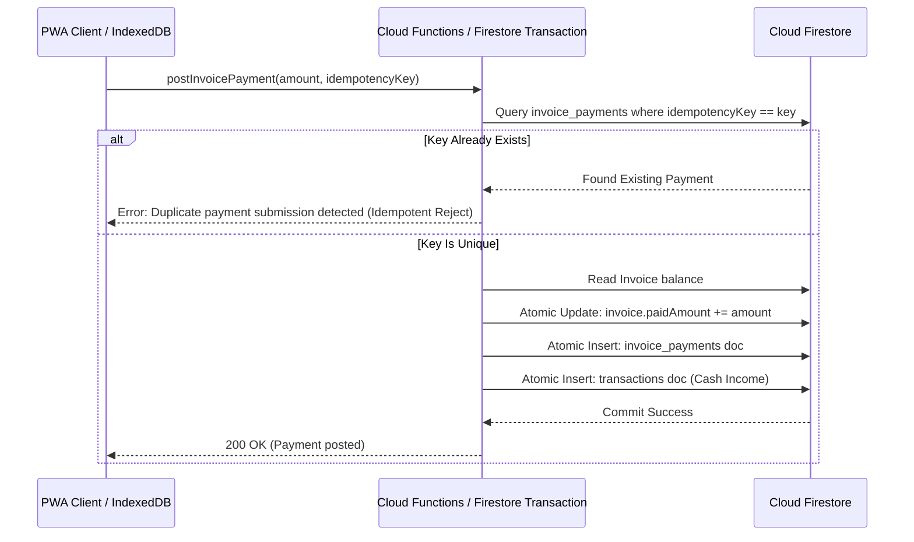

# Firestore Data Model & Financial Integrity Specification

## Overview

FinanceFlow uses **Cloud Firestore** as its canonical document store with **IndexedDB** for offline caching, background synchronization, and conflict resolution.

All financial transactions, invoices, and loans adhere to **double-entry and canonical ledger principles**:
- **Strict User-Level Isolation**: No user can read, query, or mutate another user's documents.
- **Accrual vs Cash Separation**: Unpaid client invoices are treated as *Accounts Receivable (Accrual)* and never counted as cash received until an actual payment is posted.
- **Loan Principal vs Interest Segregation**: EMI repayments are split into *Principal reduction* (balance sheet liability reduction) and *Interest charge* (profit & loss tax-deductible expense).
- **Idempotency**: All payment postings utilize deterministic idempotency keys and atomic transactions to prevent duplicate invoice settlements and duplicate EMI charges.

---

## Firestore Collections Schema

### 1. `profiles`
User profile, preferences, and currency settings.

| Field | Type | Description |
|---|---|---|
| `id` | `string` | User Auth UID (Document ID) |
| `email` | `string` | Registered email address |
| `displayName` | `string` | User full name |
| `currency` | `string` | Currency code (Strictly `'INR'`) |
| `createdAt` | `timestamp` | Profile creation timestamp |
| `updatedAt` | `timestamp` | Last update timestamp |

**Security Rules Invariant**: `request.auth.uid == userId` for all operations.

---

### 2. `transactions`
Canonical cash flow ledger (Income, Expenses, Transfers).

| Field | Type | Constraints / Description |
|---|---|---|
| `id` | `string` | Unique Transaction ID (`tx_...`) |
| `userId` | `string` | Auth UID of owner |
| `type` | `string` | Enum: `'income'`, `'expense'`, `'transfer'` |
| `amount` | `number` | Strictly positive number (`amount > 0`) in INR |
| `category` | `string` | Category (e.g. `'Groceries'`, `'Rent'`, `'Salary'`, `'Loan Interest'`) |
| `account` | `string` | Bank or payment channel (e.g. `'HDFC Bank'`, `'UPI'`, `'Cash'`) |
| `date` | `string` | ISO Date (`YYYY-MM-DD`) |
| `description` | `string` | Memo / description |
| `projectId` | `string?` | Optional reference to `projects` collection |
| `invoicePaymentId` | `string?` | Reference to `invoice_payments` doc if generated via payment |
| `loanPaymentId` | `string?` | Reference to `loan_payments` doc if generated via loan EMI |
| `idempotencyKey` | `string?` | Idempotency hash |
| `tags` | `array<string>` | Optional tags |

---

### 3. `projects`
Project budgets, client assignments, and profitability tracking.

| Field | Type | Description |
|---|---|---|
| `id` | `string` | Project ID (`proj_...`) |
| `userId` | `string` | Auth UID |
| `name` | `string` | Project name |
| `clientName` | `string?` | Client name |
| `budget` | `number` | Planned budget (`budget >= 0`) |
| `status` | `string` | Enum: `'active'`, `'completed'`, `'on_hold'` |

---

### 4. `invoices`
Accounts Receivable (Accrual) billings.

| Field | Type | Constraints / Description |
|---|---|---|
| `id` | `string` | Invoice ID (`inv_...`) |
| `userId` | `string` | Auth UID |
| `invoiceNumber` | `string` | Human invoice code (e.g. `INV-2026-001`) |
| `clientName` | `string` | Name of client |
| `clientEmail` | `string?` | Email address |
| `issueDate` | `string` | Date issued |
| `dueDate` | `string` | Payment due date |
| `projectId` | `string?` | Associated project ID |
| `items` | `array<map>` | Line items: `{ id, description, quantity, unitPrice, gstRate, total }` |
| `subtotal` | `number` | Pre-tax sum in INR |
| `taxAmount` | `number` | Calculated GST / Tax amount |
| `totalAmount` | `number` | Total invoiced amount (`totalAmount >= 0`) |
| `paidAmount` | `number` | Cumulative confirmed cash payments (`0 <= paidAmount <= totalAmount`) |
| `remainingBalance`| `number` | Derived: `totalAmount - paidAmount` |
| `status` | `string` | Enum: `'draft'`, `'sent'`, `'partially_paid'`, `'paid'`, `'overdue'`, `'cancelled'` |

---

### 5. `invoice_payments`
Canonical payment receipt records. **Immutable once written.**

| Field | Type | Constraints / Description |
|---|---|---|
| `id` | `string` | Unique Payment ID (`inv_pay_...`) |
| `userId` | `string` | Auth UID |
| `invoiceId` | `string` | Foreign key referencing `invoices` doc |
| `amount` | `number` | Cash received in INR (`amount > 0`) |
| `paymentDate` | `string` | Settlement date |
| `paymentMethod` | `string` | E.g. `'UPI'`, `'NEFT/RTGS'`, `'Cheque'`, `'Cash'` |
| `referenceNumber`| `string?` | UTR / Transaction reference |
| `idempotencyKey`| `string` | **Mandatory & Immutable**: `inv_pay_{invoiceId}_{amountCents}_{timestamp}` |

---

### 6. `loans`
Liabilities (loans taken) or Assets (loans given out).

| Field | Type | Constraints / Description |
|---|---|---|
| `id` | `string` | Loan ID (`loan_...`) |
| `userId` | `string` | Auth UID |
| `title` | `string` | Loan title (e.g. `'HDFC Home Loan'`) |
| `counterparty` | `string` | Lending institution or counterparty |
| `type` | `string` | Enum: `'taken'` (Liability), `'given'` (Asset) |
| `principalAmount`| `number` | Original principal borrowed/lent (`> 0`) |
| `annualInterestRate`| `number` | Annual percentage rate (e.g. `8.75` for 8.75%) |
| `tenureMonths` | `int` | Loan tenure in months (`tenureMonths > 0`) |
| `monthlyEMI` | `number` | Calculated using reducing balance formula: $E = P \cdot r \cdot \frac{(1+r)^n}{(1+r)^n - 1}$ |
| `remainingPrincipal`| `number` | Current outstanding principal balance |
| `startDate` | `string` | Commencement date |
| `status` | `string` | Enum: `'active'`, `'closed'`, `'defaulted'` |

---

### 7. `loan_installments`
Pre-computed monthly amortization schedule.

| Field | Type | Description |
|---|---|---|
| `id` | `string` | Installment ID (`{loanId}_inst_{installmentNumber}`) |
| `userId` | `string` | Auth UID |
| `loanId` | `string` | Foreign key referencing `loans` |
| `installmentNumber`| `int` | Sequential month index (1 to $n$) |
| `dueDate` | `string` | Due date for this installment |
| `principalComponent`| `number` | Portion of EMI reducing loan principal balance |
| `interestComponent`| `number` | Portion of EMI paying interest charge |
| `totalEMI` | `number` | `principalComponent + interestComponent` |
| `remainingBalanceAfter`| `number` | Principal balance remaining after this installment |
| `status` | `string` | Enum: `'pending'`, `'paid'`, `'overdue'` |
| `paymentId` | `string?` | Reference to `loan_payments` when paid |

---

### 8. `loan_payments`
Confirmed EMI payment executions. **Immutable once written.**

| Field | Type | Description |
|---|---|---|
| `id` | `string` | Unique Payment ID (`loan_pay_...`) |
| `userId` | `string` | Auth UID |
| `loanId` | `string` | Referenced loan |
| `installmentId` | `string?` | Referenced installment |
| `amount` | `number` | Total EMI paid in INR |
| `principalPaid` | `number` | Principal reduction |
| `interestPaid` | `number` | Interest expense |
| `paymentDate` | `string` | Date debited |
| `idempotencyKey` | `string` | Deterministic key preventing duplicate EMI charge |

---

### 9. `budgets`
Monthly category spending allocations and overrun thresholds.

| Field | Type | Description |
|---|---|---|
| `id` | `string` | Budget ID |
| `userId` | `string` | Auth UID |
| `category` | `string` | Budgeted category |
| `monthlyLimit` | `number` | Monthly limit in INR (`>= 0`) |
| `alertThreshold` | `number` | Warning percentage (default `80`) |
| `period` | `string` | Period key (`YYYY-MM`) |
| `spentAmount` | `number` | Computed monthly expenditure |

---

### 10. `savings_goals`
Milestone savings targets (Emergency funds, down payments, investments).

| Field | Type | Description |
|---|---|---|
| `id` | `string` | Goal ID |
| `userId` | `string` | Auth UID |
| `title` | `string` | Goal name |
| `targetAmount` | `number` | Target sum in INR |
| `currentAmount` | `number` | Saved sum to date |
| `targetDate` | `string` | Target completion date |
| `status` | `string` | Enum: `'in_progress'`, `'achieved'` |

---

### 11. `recurring_transactions`
Scheduled subscriptions, bills, and auto-debits.

| Field | Type | Description |
|---|---|---|
| `id` | `string` | Recurring ID |
| `userId` | `string` | Auth UID |
| `title` | `string` | Subscription / recurring bill title |
| `amount` | `number` | Amount in INR |
| `type` | `string` | Enum: `'expense'`, `'income'` |
| `category` | `string` | Transaction category |
| `frequency` | `string` | Enum: `'daily'`, `'weekly'`, `'monthly'`, `'yearly'` |
| `nextDueDate` | `string` | Next scheduled post date |
| `active` | `boolean` | Status toggle |

---

### 12. `parsed_emails`
Bank email parsing records, review queue items, and audit trails.

| Field | Type | Description |
|---|---|---|
| `id` | `string` | `email_{gmailMessageId}` (Guarantees at most 1 record per email) |
| `userId` | `string` | Auth UID |
| `gmailMessageId` | `string` | Gmail unique message ID |
| `gmailAccountId` | `string` | Sender or user Gmail address |
| `subject` | `string` | Full email subject |
| `from` | `string` | Sender address (e.g. `alerts@hdfcbank.net`) |
| `date` | `string` | Email arrival date |
| `snippet` | `string` | Email body preview |
| `parseResult` | `map` | Extracted: `amount`, `currency`, `direction`, `accountMasked`, `merchantOrDescription`, `referenceNumber`, `paymentMethod`, `suggestedCategory`, `classification`, `confidence`, `confidenceLevel`, `parserUsed` |
| `status` | `string` | Enum: `'pending_review'`, `'auto_posted'`, `'approved'`, `'rejected'`, `'ignored'` |
| `transactionId` | `string?` | Foreign key referencing created ledger transaction |
| `auditLog` | `array<map>` | Full audit trail: `{ action, timestamp, details }` |

---

### 13. `users/{userId}/settings/email_sync` & `integrations/gmail`
- `email_sync`: `{ autoPostTrusted: boolean, minConfidenceToAutoPost: number, lastSyncTimestamp: string }`
- `integrations/gmail`: `{ connectedEmail: string, refreshToken: string, updatedAt: timestamp }` (Stored strictly server-side)

---

## Idempotency & Duplicate Prevention Architecture

Financial systems must guarantee that retried network requests or accidental double-clicks never post duplicate ledger entries.

### Amortization Reducing Balance Mathematical Invariant

For every loan generated:
1. The monthly installment $E$ is derived via:
   $$E = P \cdot \frac{r(1+r)^n}{(1+r)^n - 1}$$
2. In month $k$, the interest portion is $I_k = B_{k-1} \cdot r$, and the principal portion is $P_k = E - I_k$.
3. Financial Invariant:
   $$\sum_{k=1}^n P_k = P \quad \text{and} \quad B_n = 0$$
   This ensures zero principal leakage and accurate separation of deductible interest expenses.
